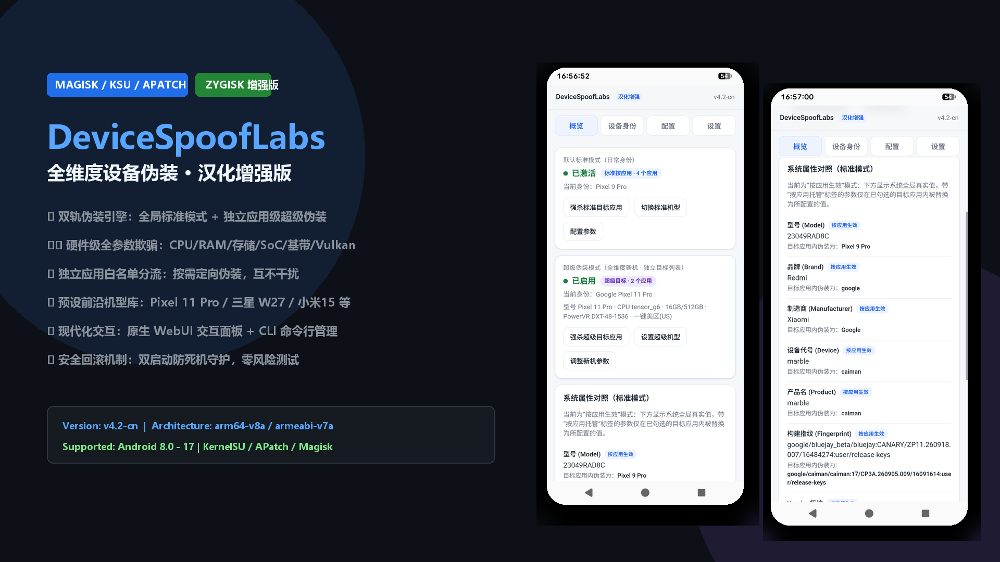
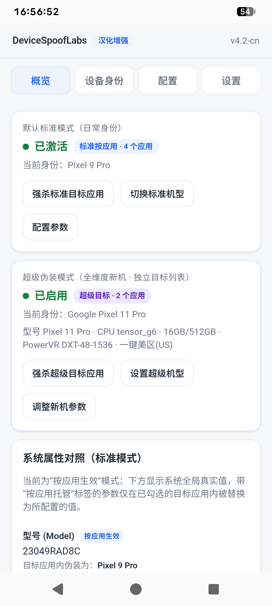
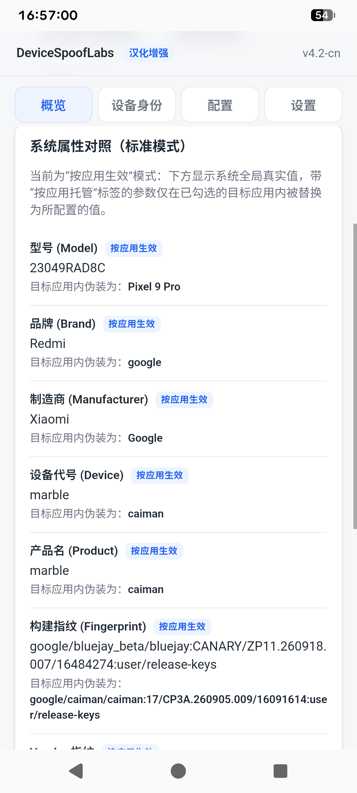

# DeviceSpoofLabs 汉化增强版 (DeviceSpoofLabs-CN)

<p align="center">
  
</p>

<p align="center">
  
  
  
  
  
</p>

---

## 📖 项目简介 (Introduction)

**DeviceSpoofLabs 汉化增强版** 是一款基于 **Zygisk** 的全维度 Android 设备特征与硬件参数伪装模块。支持在 Magisk、KernelSU 与 APatch 环境下运行。

本项目在原版强大伪装能力的基础上，进行了**深度全中文本地化适配**，并独家重构推出了**“双轨独立伪装架构”**：
- **全局标准模式 (Standard Mode)**
- **独立超级伪装模式 (Super Spoof Mode)**

双轨具备完全分离的“目标生效应用白名单”与“设备身份配置分区”，实现了不同目标应用按需匹配不同设备身份的高级测试能力。

---

## 📸 界面预览 (Screenshots)

<p align="center">
  
  
</p>

---

## ✨ 核心增强特性 (Key Features)

### 1. 🔀 双轨独立伪装引擎 (Dual-Track Isolation)
- **标准伪装轨 vs 超级伪装轨**：两套配置体系完全隔离，各拥有独立的存储分区、独立的角色 Persona，以及互不干扰的应用生效范围。
- **目标应用白名单分流**：例如可让银行类/检测类 App 生效常规标准伪装，让特定压测/风控 App 独占前沿超级伪装，一键隔离互不干扰。

### 2. 🛡️ 硬件级全参数深度欺骗 (Hardware-Level Spoofing)
- **系统核心 Props**：全分区 Product / System / Vendor / Odm / System_ext 品牌、机型、型号、制造商一致性劫持。
- **CPU 核心拓扑**：精确模拟核心数、大小核架构、SoC 家族代号、硬件平台与晶片参数。
- **GPU & 图形栈**：伪装 GL Vendor、GL Renderer (Adreno / Mali / Xclipse)、OpenGL ES 版本以及 **Vulkan Vendor ID / Device ID** 深度特征。
- **存储与内存容量**：可自定义虚拟物理 RAM 容量（8GB/12GB/16GB/24GB）及机身存储容量（128GB/256GB/512GB/1TB）。
- **电池与系统级参数**：支持电池容量 (mAh) 模拟及内核 release 版本定制。

### 3. 📱 预设前沿机型档案库 (Built-in Flagship Profiles)
内置开箱即用的主流高端旗舰与前沿机型底包档案，点击即可一键秒级套用：
- **Google 系列**：Pixel 11 Pro (`Kodiak` / Tensor G6)、Pixel 9 Pro、Pixel 8 Pro、Pixel 7 Pro
- **三星系列**：心系天下 W27 (`SM8850` / Adreno 840 / 1TB)、Galaxy S25 Ultra、Galaxy S24 Ultra、A55/A54
- **小米 / 魅族 / vivo / 一加系列**：小米 15 Ultra (`SM8750`)、小米 15、小米 14、vivo X200 Pro (天玑 9400)、一加 12、Redmi K70 等。

### 4. 🔑 关键唯一性标识与 SSAID 深度克隆 (Unique Identifiers)
- **标识符一键全量重置**：支持生成完全合规的合规序列号 (Serial)、带校验的 Luhn 算法 IMEI 1/2、Wi-Fi MAC、DRM 设备 ID 及 UUID。
- **应用级 SSAID / Android ID 精准覆盖**：支持读取、写入、同步应用级独立的 SSAID（Settings.Secure.ANDROID_ID），自带全量原始备份与一键撤销还原。

### 5. 🌐 现代化 WebUI + 强大终端 CLI (WebUI & CLI Suite)
- **原生 WebUI 支持**：在 KernelSU / APatch / KsuWebUI 中无缝弹出管理界面，全面中文字段与人性化布局。
- **终端命令行管理**：集成 `/system/bin/devicespooflabs` 工具，支持完全通过终端无头静默脚本管理一切伪装。

### 6. 🚨 双启动防死机安全守护 (Dual-Boot Loop Watchdog)
- 内置针对 `post-fs-data` 与 `service.sh` 阶段的系统看门狗守护。若伪装参数引起系统崩溃或在 30 秒内未能平稳进入桌面，**模块将自动切断异常 Persona 并还原基准状态**，彻底杜绝开机变砖！

---

## 🚀 安装与环境要求 (Installation & Requirements)

### 运行环境
- **Root 方案**：KernelSU (推荐) / APatch / Magisk 24.0+
- **Zygisk 环境**：支持并启用 Zygisk 框架（如 Zygisk Next、Zygisk on KernelSU、Magisk Zygisk 等）
- **架构支持**：`arm64-v8a` / `armeabi-v7a`
- **Android 系统版本**：Android 8.0 - 17

### 安装步骤
1. 前往 GitHub [Releases](../../releases) 页面下载最新版 `DeviceSpoofLabs-v4.2-cn.zip` 刷机包。
2. 打开 KernelSU / APatch / Magisk 模块管理器。
3. 点击“从本地安装”，选择下载的 zip 包并刷入。
4. 重启设备后即可生效。
5. 在模块列表点击操作或在桌面打开 WebUI 管理器即可进入中文控制面板。

---

## 🛠️ CLI 命令行快速参考 (CLI Usage)

```bash
# 查看当前伪装状态
devicespooflabs status

# 查看设备机型库与配置档案
devicespooflabs devices

# 生成并激活指定机型角色 (标准模式: standard / 超级伪装模式: super)
devicespooflabs generate-persona "测试机型" pixel_11_pro super

# 停用指定模式的伪装 (standard | super | all)
devicespooflabs deactivate super

# 强制停止目标应用以便伪装即时生效
devicespooflabs force-stop-targets super

# 一键生成全新合法 IMEI / MAC / Android ID / DRM ID
devicespooflabs gen-identifiers

# 还原设备原始备份
devicespooflabs restore-backup
```

---

## 📁 目录结构说明 (Project Structure)

```text
devicespooflab/
├── action.sh                  # 模块快捷操作脚本（拉起 WebUI）
├── module.prop                # Magisk / KSU 模块元数据
├── post-fs-data.sh            # 预 zygote 引导期全局属性注入与安全检测
├── service.sh                 # 后台守护进程与开机看门狗
├── uninstall.sh               # 干净卸载与数据清理
├── common/                    # 核心 Shell 控制库
│   ├── android_id.sh          # SSAID 数据库底层交互
│   ├── devices.sh             # 预设机型库解析
│   ├── personas.sh            # Persona 身份存取与切换
│   ├── prop_safety.sh         # 危险 Prop 过滤与安全守护
│   ├── state.sh               # 数据持久化目录引导
│   └── webctl.sh              # 统一命令行调度与 WebUI 桥接器
├── config/                    # 初始配置模板与机型参数
│   ├── device_profiles.conf   # 芯片/GPU/Vulkan/内存等底层特征映射表
│   └── ...
├── system/bin/                # 命令行注入工具 (devicespooflabs)
├── webroot/                   # WebUI 前端资产 (HTML/CSS/JS 全中文界面)
└── zygisk/                    # Zygisk 动态拦截与内存注入库 (.so)
    ├── arm64-v8a.so
    └── armeabi-v7a.so
```

---

## ⚖️ 免责声明 (Disclaimer)

- 本项目代码与资源仅供**安全研究、兼容性测试、移动安全压力测试与开发调试**用途。
- 严禁将本项目用于任何侵犯他人合法权益、欺诈、风控规避违规或触犯法律法规的活动。
- 使用本模块造成的一切直接或间接后果由使用者自行承担，开发者概不负责。

---

## 🤝 鸣谢与贡献 (Credits)

- 原版框架作者：[@yubunus](https://github.com/yubunus)
- 汉化与双轨增强：开源社区贡献者
- 感谢广大 Android 逆向与安全研究者的支持！
